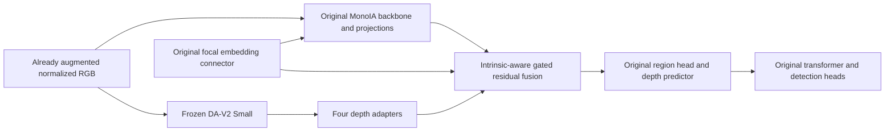

# Depth-MonoIA

**Foundation Depth Prior-Guided Intrinsic-Aware Monocular 3D Object Detection**

MSc research implementation investigating a frozen Depth Anything V2-Small prior
inside MonoIA. Improved detection, distance estimation and calibration are research
hypotheses. No training or benchmark evaluation has completed in this clean project.

The official sources are pinned as Git submodules; see
[source provenance](docs/reproducibility/sources.json) and
[third-party licensing](docs/reproducibility/THIRD_PARTY.md).

## Architecture and ablations



Per level: `F_fused = F_rgb + alpha * sigmoid(G([F_rgb,F_depth]) + W_K E_K) * F_depth`.
RGB features already contain MonoIA's original focal adaptation. Four coefficients
start at zero for exact baseline initialization; adapters/gates learn after the
first coefficient update. Relative DA-V2 depth is not metres. See the editable
[architecture report](docs/ARCHITECTURE.md).

| ID | Configuration | New fusion |
|---|---|---|
| A0 | configs/baseline/A0.yaml | None; original MonoIA |
| A1 | configs/ablation/A1.yaml | Simple residual |
| A2 | configs/ablation/A2.yaml | RGB/depth gate |
| A3 | configs/proposed/A3.yaml | RGB/depth/intrinsic gate |
| A4 | configs/ablation/A4.yaml | Optional flip-consistency reliability; locked |

All variants retain original intrinsic embeddings. A1/A2 omit only the extra
conditioning in the new fusion gate. Configs inherit pinned upstream settings:
seed 444, batch 16, 250 epochs, original custom AdamW/loss/scheduler/augmentations.
Prioritize A0/A3 when resources are limited. A4 waits for functional A0–A3 evidence.

## Installation

Vast.ai is the exclusive GPU training provider. Follow the
[beginner deployment runbook](docs/VAST_AI_RUNBOOK.md) for the reviewed image,
hardware/storage estimates, full KITTI A0–A3 commands, evaluation, Windows backups
and replacement-instance resume. Prepared commands are not GPU verification.

The target is now **RTX 4090 24 GB**. On an approved, compatible Vast Linux server,
after reviewing/committing and transferring these changes:

```bash
bash scripts/vast/setup.sh
# Fill ignored local.kitti_sources.json with authorized official URLs and trusted
# original split hashes/provenance; supply the independent G4 reference inputs.
bash scripts/vast/prepare_kitti.sh
bash scripts/vast/train_a0.sh --verify-only
bash scripts/vast/train_a3.sh --verify-only
# Only after reviewing actual capacity/gate results and approving full training:
bash scripts/vast/train_a0.sh
bash scripts/vast/train_a1.sh
bash scripts/vast/train_a2.sh
bash scripts/vast/train_a3.sh
bash scripts/vast/evaluate_all.sh
```

Run serially. Setup/preparation never train. Each training task verifies G1–G4,
uses its existing configuration and creates a unique run. Batch 16 remains the
default; 24 GB fit is **unverified**. OOM stops without batch/AMP fallback.
Explicit `--batch-size N` is a recorded protocol deviation; apply the same
reviewed batch to all comparisons. `--resume RUN_DIRECTORY` uses full-state resume.
The original split provenance and independent evaluator evidence are still missing.

`MonoIA/` and `third_party/Depth-Anything-V2/` are unmodified Git submodules.
The extension package is `depth_monoia/`. Local branch: `develop`.
No push is performed without approval. After publication:

```bash
git clone --recurse-submodules https://github.com/wolverSTW/depth-mono-thesis.git
cd depth-mono-thesis
git checkout develop
git submodule update --init --recursive
```

Local laptop checks use the existing CPU environment; no packages were changed:

```powershell
conda activate depth_monoia
python scripts/research.py verify
```

This combines syntax/import/config/source/checkpoint and isolated fusion checks.
`results/verification.json` contains actual evidence. Exit code 2 indicates pending
or failed research gates. A saved laptop record is in
`docs/reproducibility/LOCAL_VERIFICATION.json`; it is not KITTI evidence.

Prepare a Linux CUDA machine using MonoIA's documented core versions:

```bash
conda create -n depth-monoia-gpu python=3.9 -y
conda activate depth-monoia-gpu
python -m pip install torch==2.4.1 torchvision==0.19.1 --index-url https://download.pytorch.org/whl/cu121
python -m pip install -r requirements/linux-cu121.txt
# Install CUDA toolkit 12.1/nvcc and a compatible C++ compiler first.
python scripts/build_ops.py build_ext --build-lib build/ops
```

The build uses original CUDA sources with the detected GPU architecture, avoiding
upstream setup.py's fixed sm_60–sm_75 flags. The runner finds the extension under
`build/ops`. One GPU per process and float32 are supported. The full GPU stack is
prepared, not validated on this CPU laptop. Do not silently change benchmark
settings to fit memory; document and apply any revision consistently.

## Real KITTI and checkpoints

Acquire KITTI left RGB images, labels and calibration through the benchmark site.
Keep all dataset files outside Git:

```text
/datasets/KITTIDataset/
  ImageSets/train.txt
  ImageSets/val.txt
  training/image_2/000000.png ...
  training/label_2/000000.txt ...
  training/calib/000000.txt ...
```

The pinned MonoIA repository omits its split files. Obtain the designated original
split from an immutable source; do not generate a new random split. Intended
common counts 3712/3769 are not verified locally. Copy
`docs/reproducibility/dataset.example.json` to `local.dataset.json`; replace the
split source, counts and hashes with independently verified information.
`sha256sum /datasets/KITTIDataset/ImageSets/{train,val}.txt` computes hashes but
does not by itself establish provenance. G1 checks complete coverage of 7481
images, disjoint splits, duplicate IDs, counts/hashes and annotation/calibration
inventory. Dataset image authenticity relies on trusted acquisition; image bytes
are not rehashed in full. No validation labels enter training.

```bash
python scripts/research.py fetch-checkpoint --name dav2_small
python scripts/research.py fetch-checkpoint --name monoia_val
```

Downloads use official immutable model revisions and SHA-256 checks. Weights are
ignored in Git. The existing local DA-V2 copy matches the official hash. Original
MonoIA also downloads its ResNet50-vd initialization to torch hub; each run records
cache hashes. Offline machines must prepopulate the cache from the pinned
backbone's URL. Leaderboard weights are recorded but excluded from validation
because they may have seen validation labels.

## Mandatory verification gates

G1: dataset/split/checkpoint provenance. G2: real designated-train KITTI
forward/backward, initialization identity and fusion gradients. G3: atomic
save/resume with optimizer/scheduler/RNG and the same next optimization step.
G4: KITTI-compatible evaluation versus independently obtained real reference
predictions/metrics. One real train sample is used for G2–G3, not thesis results.

G4 requires full validation prediction files and JSON with `reference_source`,
validation `split_sha256`, and `metrics` containing
`Car_{3d,bev}_{easy,moderate,hard}_R40`. Identify the independent evaluator/version
and real reference run. No reference results are fabricated or supplied here.
KITTI website submission is not automated.

```bash
export KITTI_ROOT=/datasets/KITTIDataset
CUDA_VISIBLE_DEVICES=0 python scripts/research.py verify \
  --config configs/proposed/A3.yaml --manifest local.dataset.json --gpu \
  --reference-predictions /evidence/kitti_val_predictions \
  --reference-metrics /evidence/kitti_val_reference.json \
  --output results/A3_gates.json
```

Repeat for A0–A2 using the config table. Full training rejects failed gates or
mismatched code/config/data/prior identity. Review evidence; never manually change
a blocked status to PASS.

## Full training, recovery and evaluation

```bash
CUDA_VISIBLE_DEVICES=0 python scripts/research.py train \
  --config configs/proposed/A3.yaml --manifest local.dataset.json \
  --gates results/A3_gates.json --run-dir experiments/A3_intrinsic_fusion/run_001

CUDA_VISIBLE_DEVICES=0 python scripts/research.py train \
  --config configs/proposed/A3.yaml --manifest local.dataset.json \
  --gates results/A3_gates.json --run-dir experiments/A3_intrinsic_fusion/run_001 \
  --resume experiments/A3_intrinsic_fusion/run_001/checkpoints/last.pth

CUDA_VISIBLE_DEVICES=0 python scripts/research.py evaluate \
  --config configs/baseline/A0.yaml --manifest local.dataset.json \
  --checkpoint checkpoints/MonoIA_KITTI_Val.pth --official \
  --gates results/A0_gates.json \
  --run-dir results/official_A0

CUDA_VISIBLE_DEVICES=0 python scripts/research.py evaluate \
  --config configs/proposed/A3.yaml --manifest local.dataset.json \
  --checkpoint experiments/A3_intrinsic_fusion/run_001/checkpoints/best.pth \
  --run-dir results/A3_seed444
```

Run records include resolved configuration, source/code/data hashes, environment,
actual loss prints, epoch metrics and atomic latest/best full-state checkpoints.
Resume is at epoch boundaries; unfinished work is replayed. Interrupted validation
directories are preserved under a new name. Commit reviewed source before full
training. Only trusted local full-state pickle checkpoints may be loaded. These
commands do not provision cloud resources.

Main evaluation uses upstream KITTI AP_R40, Car BEV/3D IoU 0.7, original topk 50,
threshold 0.2 and prediction formatting. Auxiliary distance/ECE uses separate
documented score-ordered 3D matching; camera Z and Euclidean box-centre range are
distinct, with matched count/recall reported. Detection scores are not distance
confidence. Scores outside [0,1] make ECE inapplicable; no clipping is performed.

Resource outputs record total/trainable parameters, float32, hardware, actual
batch/image shape, warmups, batch latency, amortized per-image latency and peak
GPU memory. Full GFLOPs remain Pending until custom CUDA coverage is validated;
profiler counts are explicitly partial. Amortized batch latency is not
single-image latency.

## Editable reports and limitations

[Status](PROJECT_STATUS.md), [project instructions](AGENTS.md),
[research plan](docs/RESEARCH_PLAN.md), [milestones](docs/IMPLEMENTATION_PLAN.md),
[baseline reproduction](reports/BASELINE_REPORT.md),
[architecture](docs/ARCHITECTURE.md), [experiment protocol](docs/EXPERIMENTS.md),
[ablations](reports/ABLATION_REPORT.md), [evaluation protocol](docs/EVALUATION_PROTOCOL.md),
[evaluation report](reports/EVALUATION_REPORT.md),
[final research report](reports/FINAL_RESEARCH_REPORT.md),
[reproducibility](docs/REPRODUCIBILITY.md), [GitHub workflow](docs/GITHUB_WORKFLOW.md).

Operational workflow: [GPU setup](docs/GPU_SETUP_GUIDE.md),
[training/monitoring](docs/GPU_TRAINING_GUIDE.md),
[checkpoint management](docs/CHECKPOINT_MANAGEMENT.md),
[backup/download](docs/ARTIFACT_DOWNLOAD_GUIDE.md),
[recovery](docs/GPU_RECOVERY_GUIDE.md). Thirteen configurable GPU wrappers share
one CLI implementation. Backups use locks and per-file checksums; restoration
refuses existing destinations and unsafe archive members. These operational paths
have local tests; Linux CUDA execution is still pending.

```bash
python scripts/aggregate_results.py --search-root experiments --output results/model_comparison.csv
```

Aggregation reads only completed real evaluations, groups differing protocols and
leaves unavailable measurements blank. It does not import published results.

M1 is complete; M2–M4 implementation is prepared with real-data GPU acceptance
pending. M5–M6 execution requires Linux CUDA, real KITTI and verified splits.
Review report differences before changing manual sections. Published results,
official-weight evaluation and independent training are separate evidence types.
No improvement, novelty, training completion or benchmark performance is claimed.
Single-seed results would not establish statistical significance.

References: [MonoIA](https://github.com/alanzhangcs/MonoIA),
[Depth Anything V2](https://github.com/DepthAnything/Depth-Anything-V2),
[KITTI](https://www.cvlibs.net/datasets/kitti/eval_object.php?obj_benchmark=3d).
Acknowledgements: upstream MonoIA, DETR, Deformable DETR and DINOv2 contributors;
their notices remain in the pinned source trees.
